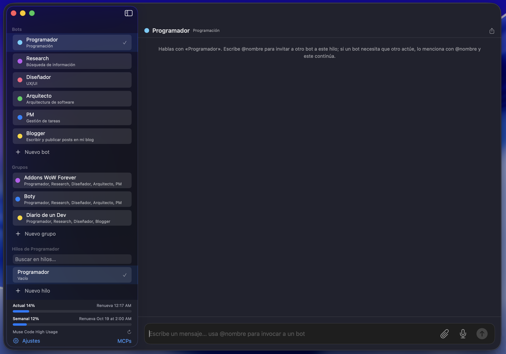

# Boty


App nativa de macOS para chatear con varios bots de IA desde una sola ventana. Cada bot tiene su propia personalidad, modelo y carpeta de trabajo, y los grupos permiten que varios bots colaboren en un mismo hilo mencionándose entre ellos. Boty se apoya en el CLI `muse` instalado en tu Mac, así que usas tu propia sesión y suscripción de Muse Code.
> [!WARNING]
> **Acceso total al Mac.** Los bots de Boty pueden leer y escribir archivos, ejecutar comandos de shell sin sandbox, navegar por la web y controlar apps del Mac (ventanas, navegador, capturas de pantalla). Revisa lo que pides a cada bot y usa solo bots y prompts en los que confíes. macOS puede pedir permisos adicionales (micrófono, reconocimiento de voz, grabación de pantalla, automatización) que se conceden en Ajustes del Sistema > Privacidad y seguridad.



## Funciones

- **Bots independientes.** Cada bot es su propia conversación, con prompt de sistema, especialidad, modelo, esfuerzo y carpeta de trabajo propios. Hilos múltiples por bot, con historial, renombrado, búsqueda y exportación a Markdown.
- **Grupos multi-agente.** Cada grupo tiene objetivo, carpeta de trabajo y bots miembros. Un mediador decide qué miembro responde, o puedes dirigirte a uno con `@nombre`. Los bots también pueden mencionarse entre ellos cuando necesitan que otro actúe, sin límite de cadena.
- **Medidor de suscripción.** Uso real de tu suscripción (ventana actual y semanal, con porcentaje y barra) leído de `/usage`, al pie de la lista de bots. Se actualiza cada 30 minutos o con el botón de recarga.
- **Adjuntos con visión.** Clip o arrastrar desde Finder. Las imágenes las ve el bot directamente; el resto (PDF, texto…) las lee con sus herramientas. Máximo 5 por mensaje y 25 MB por archivo.
- **Dictado por voz.** Transcribe en tiempo real al cajón de texto para que revises y envíes tú. Nunca envía solo.
- **Cola de mensajes.** Si escribes mientras un bot responde, tu mensaje queda en cola visible y se procesa en orden en el siguiente hueco.
- **MCPs.** Gestión de servidores MCP (stdio y HTTP) que se sincronizan con la configuración del CLI `muse`.
- **Detalles.** Bip al terminar de responder (desactivable), `Esc` detiene la respuesta en curso y `⌘+` / `⌘−` / `⌘0` ajustan el zoom de la app.

## Requisitos

- macOS 14 o superior.
- El CLI `muse` instalado y con sesión iniciada (`muse login`). Boty no funciona sin tu propia cuenta de Muse Code.

## Instalación

### Descarga (recomendado)

Descarga `Boty-1.0.0.zip` desde [Releases](https://github.com/luisjedev/boty/releases/latest), descomprímelo y mueve `Boty.app` a tu carpeta Aplicaciones. Es un binario universal (Apple Silicon e Intel) para macOS 14+.

> La app está firmada ad-hoc y no notarizada, así que la primera vez macOS puede bloquearla. Ábrela con clic derecho > Abrir, o ejecuta `xattr -dr com.apple.quarantine /Applications/Boty.app`.

### Desde el código fuente

```bash
git clone https://github.com/luisjedev/boty.git
cd boty
./scripts/bundle.sh
open Boty.app
```

En modo desarrollo (recompila si hay cambios y abre la app):

```bash
./boty
```

## Privacidad y datos locales

- Bots, grupos, hilos, adjuntos y ajustes se guardan solo en tu Mac, en `~/Library/Application Support/Boty/` (JSON). Nada de eso se sube a ningún servidor de Boty: no hay servidor de Boty.
- Boty no almacena credenciales de tu suscripción. Lanza el CLI `muse` que ya tengas instalado y autenticado, y este gestiona su propia sesión.
- Los servidores MCP que configures pueden incluir secretos (variables de entorno o cabeceras). Se guardan solo en local, con permisos restringidos, igual que la configuración del propio CLI.

## Licencia

[MIT](LICENSE) — Copyright (c) 2026 luisjedev

---

*Boty es un proyecto independiente. No está afiliado, respaldado ni patrocinado por Meta, xAI ni OpenAI. «Muse», «Muse», «Grok» y «ChatGPT» son marcas de sus respectivos propietarios. Para usar Boty necesitas tu propia suscripción y sesión de Muse Code, sujeta a los términos de Meta.*
